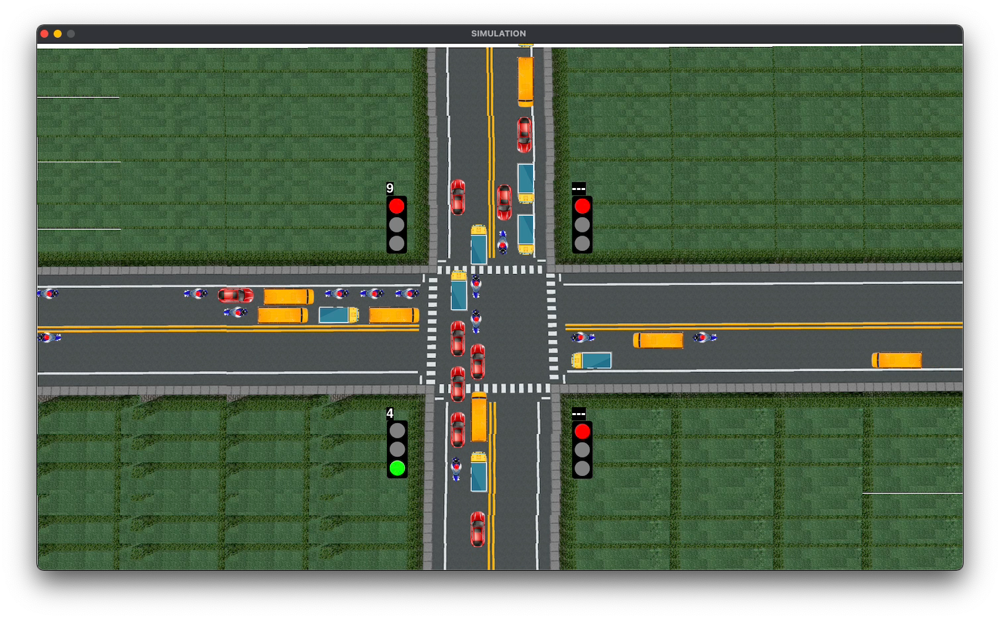
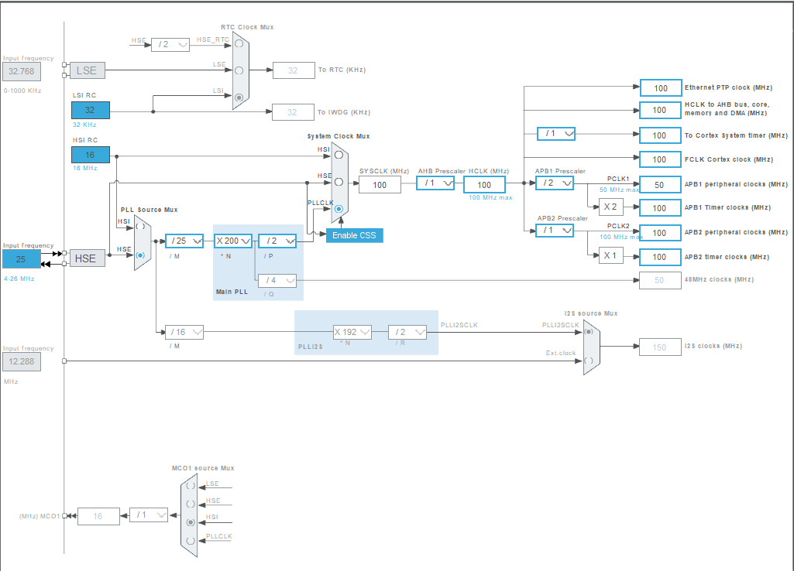

# Bare-Metal RTOS & HIL Traffic Control System

A custom real-time operating system kernel built from scratch for the ARM Cortex-M4 (STM32F411CEU6), running an event-driven, object-oriented traffic intersection controller in a Hardware-in-the-Loop (HIL) configuration with a 2D physics simulation.

[](https://drive.google.com/file/d/19grhn3pTRBFwskhOVj2016WNKYPhxOA9/view?usp=drivesdk)

> 📹 **Video Demonstration**: [Watch the Full Hardware-in-the-Loop Video Demo on Google Drive](https://drive.google.com/file/d/19grhn3pTRBFwskhOVj2016WNKYPhxOA9/view?usp=drivesdk)

---

## Overview

Rather than relying on generic off-the-shelf RTOS stacks like FreeRTOS or Zephyr, this project implements a **custom bare-metal preemptive real-time kernel** and pairs it with advanced **Object-Oriented Programming (OOP) in ANSI C** design patterns. 

The application architecture utilizes the **Active Object (AO) pattern**, **Run-to-Completion (RTC) state machines**, **Virtual Method Tables (vtables)** for dynamic polymorphism, a **deterministic LIFO memory pool**, and an **Observer (Publish-Subscribe) IPC** mechanism. The embedded controller acts as a closed-loop hardware agent regulating a multi-lane 4-way intersection simulated in real time over UART.

---

## Core Engineering & Design Highlights

### 1. Object-Oriented Programming & Polymorphism in C
- **Virtual Method Tables (`vtable`)**: Runtime dynamic binding in pure C using struct function-pointer tables (`input_vtable`, `master_vtable`, `out_vtable`).
- **Encapsulation & Inheritance-like Structs**: Base struct composition (`mail`, `fifo`, `vptr`, private state) providing unified interface inheritance across all active components.
- **Universal Payloads**: Tagged discriminated union (`universal_payload`) encapsulating multi-format messages without dynamic memory overhead.

### 2. Active Object Pattern & Concurrency
- **Decoupled Autonomous Entities**: Each subsystem (`Input`, `Master`, `Output`) is designed as an Active Object possessing its own private state, event queue (FIFO ring buffer), and dedicated RTOS thread.
- **Run-to-Completion (RTC) Execution**: Event handling is deterministic and atomic per task iteration, eliminating internal race conditions between tasks.
- **Observer Pattern IPC**: Decoupled publisher-subscriber model (`mail`) allowing Active Objects to notify subscribed handlers polymorphically via `publish()`.

### 3. Custom Preemptive RTOS Kernel (vs. FreeRTOS)
- **Bare-Metal Context Switcher**: Low-overhead context switching implemented directly in ARM Cortex-M4 assembly via naked `PendSV_Handler` and `SVC_Handler`.
- **$O(1)$ Bitmask Scheduler**: Single-cycle priority task discovery using a 32-bit ready register (`ready_reg`) and hardware-accelerated count-leading-zeros (`__builtin_ctz` / `CLZ`).
- **Dual Stack Operation**: Strict separation of Main Stack Pointer (MSP) for kernel/interrupt handlers and Process Stack Pointer (PSP) for individual tasks.
- **Deterministic 100 Hz Timebase**: SysTick timer driving 10 ms resolution delay queues (`rtos_delay`) and cooperative yielding (`rtos_yield`).

### 4. Deterministic LIFO Memory Pool
- **Boot-Time Allocation Only**: Dynamic heap `malloc()` is executed strictly once during startup initialization (`functions_init`), eliminating runtime heap fragmentation and memory leaks.
- **$O(1)$ LIFO Intrusive Recycling**: Constant-time node allocation and recycling (`pop_pool` / `push_pool`) with interrupt-safe critical sections.

### 5. Algorithmic Intelligence & Traffic Engine
- **Greedy Optimization**: Selects the approach with the highest vehicle queue density to maximize traffic clearance efficiency.
- **Anti-Starvation Bounding**: A strict 90.0-second (9,000 tick) threshold prevents greedy starvation by forcibly granting green light to long-waiting lanes.
- **Emergency Vehicle (EV) Preemption**: Immediate preemption pipeline with safe yellow clearance, EV green phase, and automatic state restoration returning to the interrupted lane.

### 6. Streaming I/O & Fault Tolerance
- **Non-Blocking Streaming UART Lexer**: Re-entrant byte parser preserving state across partial byte receipts (`input_parse_state`), preventing buffer overflows and context loss.
- **Heartbeat & Watchdog Fail-Safe**: Continuous 10 Hz heartbeat (`i1`). A 3-second host watchdog detects MCU halts or disconnects and drops all signals to RED.

---

## System Architecture

```
+---------------------------------------------------------------------------------------+
|                             STM32F411CEU6 Firmware                                    |
|                                                                                       |
|  [ Active Object: Input ]    [ Active Object: Master ]    [ Active Object: Output ]   |
|   - Non-blocking Lexer        - Greedy Priority Logic      - Signal Serializer        |
|   - Packet State Recovery     - 90s Starvation Timer       - 10 Hz Heartbeat Generator|
|   - Polymorphic `vptr`        - Run-to-Completion FSM      - Polymorphic `vptr`       |
|             |                 - Polymorphic `vptr`                 ^                  |
|             |                          |                           |                  |
|             +----------> [ Observer Dispatcher / Mail ] -----------+                  |
|                                        |                                              |
|                                        v                                              |
|        +-------------------------------------------------------------+                |
|        |                  Custom RTOS Kernel                         |                |
|        | - PendSV Context Switcher  - Bitmask O(1) Priority Scheduler|                |
|        | - SVC Thread Bootstrapper  - LIFO Node Memory Pool          |                |
|        +-------------------------------------------------------------+                |
+----------------------------------------|----------------------------------------------+
                                         | Full-Duplex UART (PA9/PA10 @ 9600 8N1)
                                         | Line-Delimited ASCII Protocol
+----------------------------------------v----------------------------------------------+
|                     Host-Side 2D Simulation (Python/Pygame)                           |
|                                                                                       |
|   [ Serial IO Thread ]      [ Intersection Engine ]          [ Pygame UI ]            |
|    - 3s Watchdog Monitor     - 4-Way Vehicle Physics          - Real-Time Intersection|
|    - Queue Meter Calculation - Multi-Lane Stop Lines          - Emergency Injector    |
|    - EV Preemption Trigger   - Kinematic Vehicle Sprites      - Spawn Rate Control    |
+---------------------------------------------------------------------------------------+
```

---

## Software Patterns & Implementation Details

### 1. Polymorphic Virtual Tables (`vtable`) in C
Dynamic runtime polymorphism is achieved through explicit vtable structures. Each object contains a pointer to its static vtable:

```c
// Abstract interface for notification
struct master_vtable {
    bool (*on_notify)(fifo* const me, node* data);
    void (*pop_master)(void* me);
    void (*stuff)(void* me);
};

typedef struct {
    mail _mail;              // Base subscriber list
    master_vtable* vptr;     // Virtual method table pointer
    fifo queue;              // Private event queue
    uint8_t current_green;   // Active state
    // ...
} master;
```

When an event is published, the dispatcher invokes the derived subscriber's concrete implementation through the `vptr` without knowing the underlying structure's internal layout:

```c
bool publish(void* _me, node* data) {
    mail* me = (mail*)_me;
    for (int i = 0; i < me->current_max; ++i) {
        switch (*((struct_id*)(me->list[i]))) {
            case master_struct_id:
                ((master*)(me->list[i]))->vptr->on_notify(&((master*)(me->list[i]))->queue, data);
                break;
            // ...
        }
    }
    return true;
}
```

### 2. Deterministic LIFO Memory Pool
To prevent heap fragmentation in long-running embedded systems, dynamic memory allocation is restricted to boot time. A fixed pool of intrusive `node` elements is initialized into a LIFO stack:

```c
typedef struct node {
    union {
        struct node* next;
        universal_payload message;
    };
} node;

// Interrupt-safe LIFO pool pop: O(1)
node* pop_pool(pool* tool) {
    __disable_irq();
    node* temp = tool->head;
    if (temp != NULL) {
        tool->head = temp->next;
    }
    __enable_irq();
    return temp;
}
```

### 3. $O(1)$ Bitmask Priority Scheduler
The scheduler evaluates task priorities in constant time $O(1)$ using the ARM Cortex-M4 hardware `CLZ` (Count Leading Zeros) via `__builtin_ctz`:

```c
void SYS_prep(void) {
    int curr_i = SYS_i;
    prev = arr[SYS_i];

    for (int i = 0; i < (mx_thread + 31) / 32; i++) {
        if (ready_reg[i] != 0) {
            SYS_i = 32 * i + __builtin_ctz(ready_reg[i]);
            break;
        }
    }

    if (curr_i == SYS_i) return;

    curr = arr[SYS_i];
    SCB->ICSR |= SCB_ICSR_PENDSVSET_Msk; // Trigger PendSV context switch
}
```

---

## Traffic Control & Algorithmic Design

### 1. Greedy Scheduling Heuristic
The core selection heuristic evaluates all waiting lanes and greedily selects the lane with the largest queue:

```c
// Proportional Green Duration: 1.5s base up to 6.0s max
green_duration_ticks = 150 + ((uint32_t)q_len * 450) / 50;
```

### 2. 90-Second Anti-Starvation Bounding
To ensure mathematical fairness and avoid starvation for low-density approaches, the algorithm tracks waiting duration:

$$\text{Starvation Condition: } (t_{\text{current}} - t_{\text{last\_green}}[i]) \ge 9000 \text{ ticks } (90.0\text{s})$$

If any lane breaches this threshold, the greedy heuristic is bypassed, and green priority is immediately transferred to the starving lane.

### 3. Emergency Preemption & Recovery
```
[ Normal Cycle: GREEN ] 
         | 
   (EV Received: 'Ed')
         v
[ STATE_EMERGENCY_YELLOW ] (1.5s clearance, save interrupted_dir)
         v
[ STATE_EMERGENCY_GREEN ]  (Hold until 'Cd' clear or 15s timeout)
         v
[ Resume interrupted_dir ] (Restores interrupted lane smoothly)
```

---

## UART Wire Protocol

Communication operates at **9600 baud, 8N1** with ASCII frames:

### Direction Indices
- `0` / `r` / `R`: Right (Eastbound)
- `1` / `d` / `D`: Down (Southbound)
- `2` / `l` / `L`: Left (Westbound)
- `3` / `u` / `U`: Up (Northbound)

### Frame Specification

| Origin | Format | Example | Purpose |
|---|---|---|---|
| **MCU** | `i1\n` | `i1` | 10 Hz Heartbeat keepalive |
| **MCU** | `<dir><state>\n` | `r11` | Signal state (`11` = Green, `01` = Yellow, `00` = Red) |
| **Host** | `<DIR><len>\n` | `R30` | Queue length update (`R` lane = 30m) |
| **Host** | `E<dir>\n` | `Ed` | Emergency Vehicle preemption trigger for lane `d` |
| **Host** | `C<dir>\n` | `Cd` | Emergency Vehicle cleared intersection notification for lane `d` |

---

## Hardware Configuration & Pinout

- **Target Microcontroller**: STM32F411CEU6 ("Black Pill", ARM Cortex-M4F @ 100 MHz)
- **Clock Tree**: HSE (25 MHz Crystal) $\to$ PLL $\to$ 100 MHz SYSCLK, APB1 = 50 MHz, APB2 = 100 MHz
- **Tick Frequency**: SysTick @ 100 Hz (10 ms per tick)

### Clock Tree Configuration



### Hardware Connections

| STM32 Pin | Function | External Connection |
|:---:|:---:|:---:|
| `PA9` | USART1_TX (AF7) | USB-to-UART RXD |
| `PA10` | USART1_RX (AF7) | USB-to-UART TXD |
| `PC13` | GPIO Output | Onboard User LED |
| `GND` | Ground | Common Ground |
| `3.3V` / `5V` | VCC | Target Power Supply |

---

## Directory Structure

```
├── assets/
│   └── clk.png                  # STM32CubeMX clock tree diagram
├── Core/
│   ├── Inc/
│   │   ├── main.h               # HAL config & peripheral headers
│   │   ├── gpio.h               # GPIO port configurations
│   │   └── usart.h              # USART1 peripheral definitions
│   └── Src/
│       ├── main_traffic.c       # RTOS kernel, PendSV/SVC handlers, SysTick timebase
│       ├── traffic.c            # Active Objects, FSM, Vtables, LIFO memory pool, IPC
│       ├── delay.h              # Kernel control blocks, OS_boy struct, prototypes
│       ├── gpio.c               # Low-level GPIO configuration
│       ├── usart.c              # Non-blocking USART hardware driver
│       └── system_stm32f4xx.c   # System clock tree configuration
├── python-2d-enivroment/
│   ├── images/                  # Sprite graphics (intersection, vehicles, lights)
│   ├── simulation.py            # Pygame 2D traffic simulator & HIL serial bridge
│   ├── simulation-output.png    # Screenshot preview of simulation
│   └── LICENSE                  # MIT License (2D Simulation environment)
├── STM32F411CEUX_FLASH.ld       # Linker script
├── traffic_manage_on_top_of_custum_rtos.ioc # STM32CubeMX hardware specification
├── LICENSE                      # GNU General Public License v3.0
└── README.md                    # Project documentation
```

---

## Build & Setup

### 1. Build and Flash Firmware (STM32CubeIDE)

1. Launch **STM32CubeIDE** and import the project repository (`File -> Import... -> Existing Projects into Workspace`).
2. Compile the binary (`Ctrl + B`).
3. Connect an **ST-LINK V2** programmer to SWD pins (SWDIO, SWCLK, GND, 3.3V).
4. Flash the target: `Run -> Run` (`Ctrl + F11`).

### 2. Run the 2D Python Simulation

#### Requirements
Install Python dependencies:

```bash
pip install pygame pygame_gui pyserial
```

#### Starting the Simulation
Connect the USB-to-UART adapter to your machine and launch the simulator:

```bash
# Windows (PowerShell)
$env:STM32_PORT="COM3"
python python-2d-enivroment/simulation.py

# Linux / macOS
export STM32_PORT=/dev/ttyUSB0
python python-2d-enivroment/simulation.py
```

The status badge in the top bar will turn **STM32 ONLINE** (Green) upon establishing synchronization.

---

## Credits & Attribution

The 2D intersection simulation in `python-2d-enivroment/` is based on the traffic simulation project developed by **Mihir Gandhi**.

- **Original Author**: Mihir Gandhi
- **License**: [MIT License](python-2d-enivroment/LICENSE) (Copyright (c) 2021 Mihir Gandhi)
- **Modifications**: Integrated multi-threaded serial communication layer, bi-directional packet protocol, real-time queue length estimator, heartbeat failsafe watchdog, and interactive emergency vehicle injection UI.

---

## License

- Core firmware, RTOS kernel, and traffic control logic: [GNU General Public License v3.0 (GPLv3)](LICENSE).
- 2D simulation environment and assets: [MIT License](python-2d-enivroment/LICENSE).


